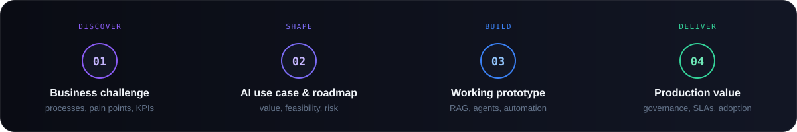

  

  
  
  

 

## ✦ How I create value

I work where **Generative AI meets business processes**. I lead Application Maintenance Services at SDG Group Italy, so I know what it takes for an AI idea to survive SLAs, governance and real users. I also build the systems myself, to prove the value before it is scaled.

## ✦ Featured work

<table>
<tr>
<td width="50%" valign="top">

<code>AGENTIC AI · IT SERVICE MANAGEMENT</code>
### [Jarvis](https://github.com/tortonef/jarvis-servicenow)
AI assistant for the Service Desk: it suggests cited resolutions on every new ServiceNow incident and runs only approved fixes, with approval that scales with risk.

</td>
<td width="50%" valign="top">

<code>RAG · FASHION RETAIL</code>
### [AI Stylist](https://github.com/tortonef/ai-stylist-rag)
Conversational stylist that builds complete outfits from a real catalog within budget. Every product is cited by SKU; 95% of products shown met every constraint.

</td>
</tr>
<tr>
<td width="50%" valign="top">

<code>MCP · DATA QUALITY</code>
### [MCP data quality agent](https://github.com/tortonef/mcp-data-quality-demo)
Claude with two MCP servers finds data quality issues in a database and opens one ServiceNow incident per anomaly, with no duplicates on reruns.

</td>
<td width="50%" valign="top">

<code>CONVERSATIONAL ANALYTICS</code>
### [Chat Dashboard](https://github.com/tortonef/chat-dashboard)
A dashboard you build by chatting: requests become validated, read-only SQL and charts, with global filters that work on any query.

</td>
</tr>
<tr>
<td width="50%" valign="top">

<code>ANOMALY DETECTION · RETAIL</code>
### [Atelier Watch](https://github.com/tortonef/atelier-watch)
ETL with a 20-rule quality gate, z-score and Isolation Forest detectors, and LLM alerts to Slack. Recovers 100% of seeded anomalies at 75% precision.

</td>
<td width="50%" valign="top">

<code>COMPUTER VISION · E-COMMERCE</code>
### [Fashion Catalog Enrichment](https://github.com/tortonef/fashion-catalog-enrichment)
Product photo to catalog-ready attributes with confidence scores and human review. 81% category accuracy at ~0.1 s per image, no training, no API keys.

</td>
</tr>
<tr>
<td width="50%" valign="top">

<code>DEEP LEARNING · DEVELOPER TOOLS</code>
### [Neural Network Templater](https://github.com/tortonef/neural-network-templater)
Describe a problem, get a ready-to-train Keras or PyTorch script with every choice explained. [**Live demo →**](https://tortonef.github.io/neural-network-templater/)

</td>
<td width="50%" valign="top">

<code>INTERACTIVE PORTFOLIO</code>
### [Interactive GenAI Lab](https://github.com/tortonef/agentic_ai)
A multi-agent simulator, a step-by-step RAG explorer and a prompt-technique comparator, all running in the browser. [**Open it →**](https://tortonef.github.io/agentic_ai/)

</td>
</tr>
</table>

## ✦ Toolbox

| Area | Stack |
|---|---|
| **GenAI & LLMs** |     |
| **Agents & RAG** |      |
| **Data platforms** |       |
| **Machine learning** |    |
| **Delivery** |     |

## ✦ Certifications

  
  
  
  
  
  
  

---

  M.S. in Physics, La Sapienza · thesis on AI for the ATLAS trigger at CERN, published in <i>The European Physical Journal C</i> 
  Founder of an internal AI Community · Rome, Italy

